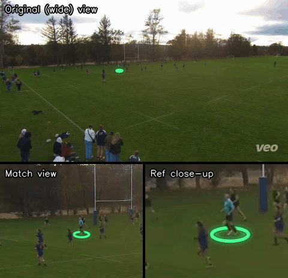
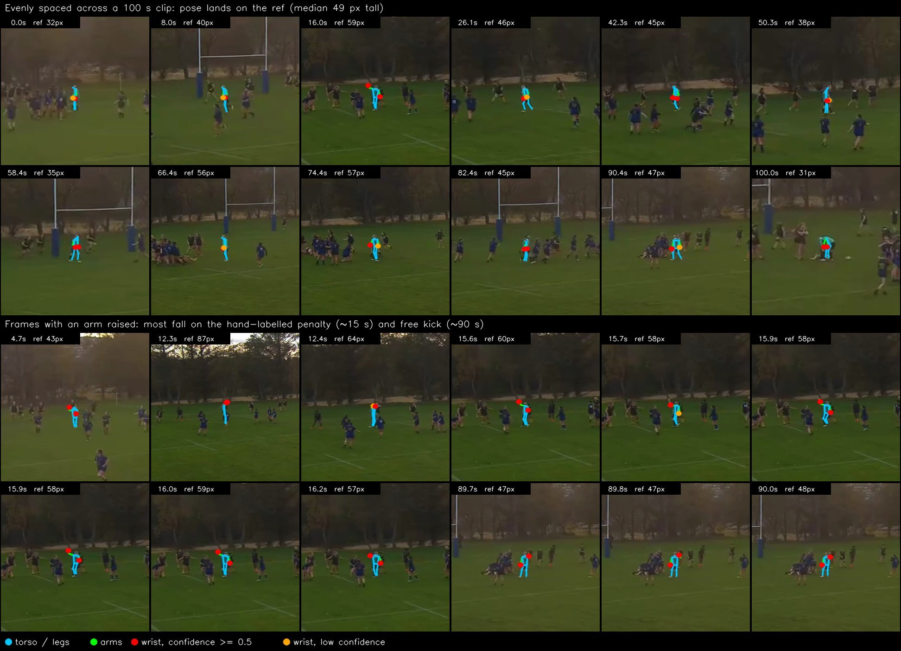

# David Nicol

Hands-on tech leader specialising in conversational AI, multi-agent orchestration, RAG architectures, and context engineering.

I build things end-to-end: from infrastructure (AWS/Terraform/Kubernetes) through backend systems to AI pipelines and user experience. Career spanning fintech, video delivery (local and broadcast IP), e-commerce, and now AI/ML.

### What I'm working on

**[RefTracker](https://github.com/dznicol/reftracker)** - computer vision + Gemini pipeline that tracks rugby referees and explains their decisions. YOLOv8 (detection, pose, segmentation), BoTSORT/CLIP-ReID, OpenCV, Gemini

  

YOLOv8 person detection picks the referee by their unique kit (shirt) colour every frame, falling back to multi-object tracking (BoTSORT + CLIP-ReID) when the colour isn't separable. Velocity clamping to real running speeds, camera-motion compensation, and teleport detection (rejecting physically impossible between-frame jumps) keep the marker locked to the right person — who is only ~40px tall in the original 1920×1080 footage. The three panels are a single tracking pass shown at three zoom levels.

  

Next phase: logging every referee decision from pose. YOLOv8-pose runs on a ref-centred crop of each tracked frame, producing a 17-keypoint skeleton. Frames where an arm is raised cluster on the hand-labelled penalty and free kick, the first step towards a signal classifier and a labelled rugby referee signal dataset.

### Areas of focus

- **AI/ML** - LLM application development, multi-agent orchestration, RAG, context engineering, evaluation and safety pipelines, conversational AI, computer vision
- **Infrastructure** - AWS, Terraform, Docker, Kubernetes, IP networking, video delivery
- **Product** - 0-to-1 product architecture, UX-driven development, full-stack delivery

### Connect

